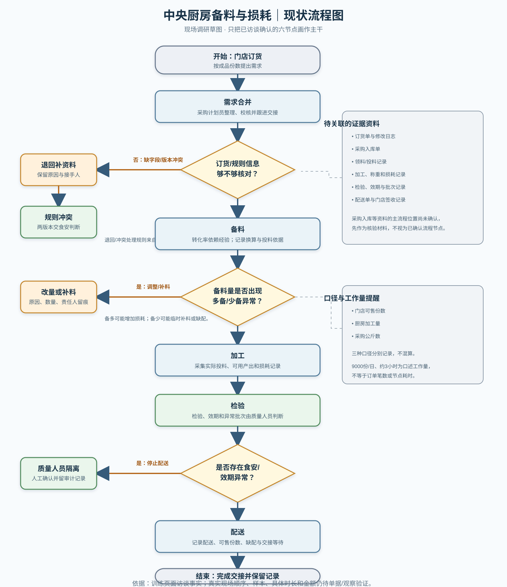

# 05 现状流程图

SVG 原图：[05-现状流程图.svg](05-现状流程图.svg)

**图例：**矩形为流程步骤，菱形为判断，橙色为异常/退回分支，绿色为必须由人工完成的确认。

## 已确认主干

门店订货 → 需求合并 → 备料 → 加工 → 检验 → 配送。

该主干来自顾明岚的流程陈述（`food-purchasing-f01`）。采购入库单、领料/投料记录作为交叉核验资料，其实际发生节点仍待现场跟单确认，不在图中作为已确认的主干步骤。

## 判断和异常路径

- 规则/版本/批次一致？不一致时保留版本并交食安质控员判断；具体审核阈值待确认。
- 备料量异常？退回时保留原因、改量/补料记录及接手人（`food-purchasing-f20`）。
- 食安/效期异常？质量人员隔离，模型不得更改检验结论或效期（`food-purchasing-f40`）。
- 缺配或交接异常？记录缺配份数、等待和重新联系；统一分母和采集周期待确认。

## 重要限制

现图是根据合成访谈形成的调研草图，不是现场观察确认过的 SOP。具体品类、订单号、批次、处理时长、退回频次和损耗金额仍须原始单据和现场观察验证。

